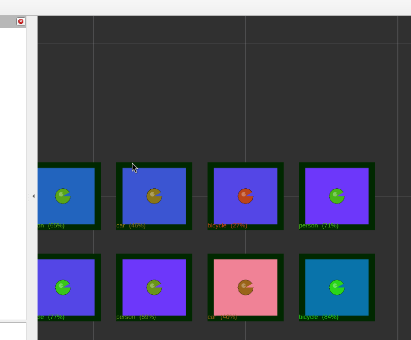

<!--
SPDX-License-Identifier: Apache-2.0
SPDX-FileCopyrightText: Czech Technical University in Prague
-->

# RViz visualisation of vision_msgs detections

`cras_rviz_vision_msgs/Detection2DArray` displays `vision_msgs/msg/Detection2DArray` messages in RViz.

Each detection is shown at the position of the pose belonging to its most probable class hypothesis (the hypothesis
with the highest `score`). The position is marked by a small solid sphere, the same way the `PointStamped` display
shows a point, and a text label with the class name and its probability, and optionally a preview of the source camera
image are attached to it. Everything is projected into the currently active view, which makes the visualisation work
with any camera – the view `TopDownOrtho` being the typical use case.

## More detections than a message contains

A detector typically publishes the objects it sees repeatedly and publishes an empty array when it sees nothing, so the
display does not show only the contents of the newest message:

- The detections of the older messages are kept, which is also why an empty message does not hide anything. How many of
  them are kept is limited by *Markers/Max. detections* (default 2000) and optionally by *Markers/Detections
  lifetime*; the oldest detections are dropped first and the number of the dropped ones is reported in the status of
  the display.
- A detection which is published again with the same ID (in the same frame) is updated in place, so a tracked object
  does not pile up. Detections without an ID are kept as separate ones, because nothing tells them apart.
- With hundreds of detections, only the most important ones (the most probable ones, and those in the centre of the
  view) get a text label and an image preview; the rest is drawn as a plain sphere, so the scene stays readable and
  fast to render.



## Image previews

The images the detections come from are subscribed on the topic set in the *Image topic* property, which offers both
`sensor_msgs/msg/Image` topics (subscribed with `cras::ImageTransport`, so a transport plugin such as `theora` can be
used if it is available) and `sensor_msgs/msg/CompressedImage` topics (decoded by OpenCV). The image whose timestamp is
the closest to the timestamp of the detection message (within *Image time tolerance*) is used as the source of the
previews of that message, and the part of it around the detection bounding box is shown. The preview is drawn in the
plane of the screen, so it always faces the camera.

Showing a preview of every detection would quickly become unreadable, especially when the detections are close to each
other. The display therefore adapts to the space available in the view:

- The previews are placed by a simple layout planner, which never lets two annotations overlap and prefers the places
  where the least number of detections is covered.
- The most probable detections (and those in the centre of the view) get the best places. When there is not enough
  space for a preview, it is made smaller and smaller until it is at least *Min. preview width* wide. When that is not
  enough, the detection is only plotted as a plain marker with a text label – but its label is still placed to a free
  place, so a pile of detections remains readable.
- When the user zooms in, the detections spread out in the view and space for further previews appears.

## Trying it out

```
$(ros2 pkg prefix cras_rviz_vision_msgs)/share/cras_rviz_vision_msgs/demo/fake_detector.py 12 cluster &
rviz2 -d $(ros2 pkg prefix cras_rviz_vision_msgs)/share/cras_rviz_vision_msgs/rviz/detections.rviz
```

The demo publisher publishes a grid of detections (in one dense circle with `cluster`) together with synthetic camera
images on `/image`, so zooming in and out shows how the number of visible previews changes. With the `sparse` option,
every message contains other detections with new IDs (so the display has to keep them all), `empty` makes the detector
regularly see nothing, `compressed` sends the images on `/image/compressed` and `sim` publishes the `/clock` topic::

    # a lot of detections arriving in separate messages
    $(ros2 pkg prefix cras_rviz_vision_msgs)/share/cras_rviz_vision_msgs/demo/fake_detector.py 300 sparse empty &
    # or a small dense crowd, to show how the previews make room for each other
    $(ros2 pkg prefix cras_rviz_vision_msgs)/share/cras_rviz_vision_msgs/demo/fake_detector.py 12 cluster &

## Time

The age of the detections (*Detections lifetime*) and the time period of the loaded history are resolved by the ROS
clock of the RViz node, so both follow the simulation time when RViz runs with `use_sim_time` and the `/clock` topic is
published (e.g. when playing a bag). Until the clock is driven, the wall clock is used.

## Properties

| Property | Meaning |
| --- | --- |
| *Topic* | The `vision_msgs/msg/Detection2DArray` topic to visualise. |
| *Image topic* | Camera images the detections come from. Empty to only draw the detection markers. |
| *Image time tolerance* | Maximal time difference between a detection message and an image to use it [s]. |
| *Images to cache* | How many last images to keep in memory. |
| *Markers/Size* | Diameter of the drawn sphere of a detection [m]. |
| *Markers/Line width* | Width of the outline of the sphere [px]. 0 draws only the filled sphere. |
| *Markers/Keep older detections* | Whether the detections from the older messages stay visible. |
| *Markers/Max. detections* | Maximal number of the kept detections; the oldest ones are dropped when it is exceeded. |
| *Markers/Detections lifetime* | How long the detections are kept [s]. 0 keeps them until the limit above is exceeded. |
| *Markers/Min. probability* | Detections with a lower probability than this are not visualized. |
| *Markers/Color by* | Whether the colour of the marker expresses the probability, the class, or nothing. |
| *Labels/…* | Which information to show in the text label next to each detection, and in which font. |
| *Labels/Max. labels* | Maximal number of labels shown at once; the most probable detections are labelled first. |
| *Image previews/Show image previews* | Whether the detections can be shown with an image preview. |
| *Image previews/Preview padding* | How much bigger part of the image than the detection bounding box to show. |
| *Image previews/Preview width* | Width of a preview when there is enough free space around the detection [px]. |
| *Image previews/Min. preview width* | Below this width the preview is not shown at all [px]. |
| *Image previews/Max. previews* | Maximal number of detections shown with a preview; each of them needs a texture. |
| *Image previews/Avoid overlaps* | Disables the layout planner; every detection then shows its preview centred at the detection, whatever the consequence is. |
| *Image previews/Spacing* | Minimal spacing between two annotations [px]. |
| *Persistent history/Show history* | Whether the detections read from the persistent storage are shown together with the received ones. |
| *Persistent history/Storage folder* | Folder with the stored detections. Defaults to `$ROS_HOME/g4s_mission`, a leading `~` is expanded. |
| *Persistent history/Global frame* | Frame the stored global positions are expressed in, typically `FP_ECEF`. Empty to show the detections in the local frame of the mission they were recorded in. |
| *Persistent history/Load from (s ago)* | Age of the oldest detection to load [s]. |
| *Persistent history/Load to (s ago)* | Age of the newest detection to load [s], 0 loads the detections up to now. |
| *Persistent history/Max. stored detections* | Maximal number of stored detections to show; the newest ones are kept. |
| *Persistent history/Classes* | Comma-separated list of the classes to load, empty for all of them. |
| *Persistent history/Keep-out zones* | Whether to show only the detections recorded inside a keep-out zone, or outside of all of them. |
| *Persistent history/Use stored images* | Whether the previews of the stored detections can be taken from the images saved with them. |
| *Persistent history/Reload period* | How often to read the storage again [s]. 0 loads the history only when the settings change. |

## Persistent history

Besides the detections received on a topic, the display can also show the detections read from the persistent
detection storage written by the `detection_recorder` node of the `g4s_mission` package. Both sources are shown at
once, so the operator can see where the objects were seen before and what the detector reports right now. The
differences between the two sources are deliberate:

- The recorder stores the global (Earth-centred) position of every localized detection, so the stored detections are
  placed in the *Global frame* (default `FP_ECEF`) when it is part of the current TF tree. That is the only position
  which means the same place in the next mission, when the local frame of the robot starts elsewhere. Detections
  recorded without it, i.e. by an older version of the recorder, are placed by the newest known transform of the frame
  they were recorded in, because the transform of their (long past) timestamp is not available anymore. Their preferred
  position is then the one in the frame of the keep-out zones, which the recorder resolved when the detection arrived.
  Set the *Global frame* property to an empty string to always use the local frame of the recorded mission.
- Their preview comes from the image cropped around the detection bounding box and saved with it, so no live camera
  images are needed to look at the history.
- Their label carries the time of the detection and the number of the keep-out zone it was recorded in, and the
  *Color by* property offers a *Keep-out zone* mode which colours the detections inside a zone red and the ones
  outside of every zone green. Reading a longer period this way shows where the intrusions happened.

The storage layout (one `detections_YYYY-MM-DD.csv` per day and the crops in `images/YYYY-MM-DD/<class>/`) and the
numbering of the zones are documented in the `g4s_mission` package, which also provides a command-line tool to query
the same data.

## Limitations

- A detection without a pose in `results[].pose.pose` cannot be placed in the scene, so it is not visualised (the
  display reports it in its status). Use an image overlay tool if your detections have no 3D poses. This applies to
  the stored detections with an unknown pose as well, they are only listed in the status of the history.
- The sphere marking a detection has the same size for all of them (the *Markers/Size* property), because
  `vision_msgs/msg/Detection2D` does not carry the 3D dimensions of the detected object.
